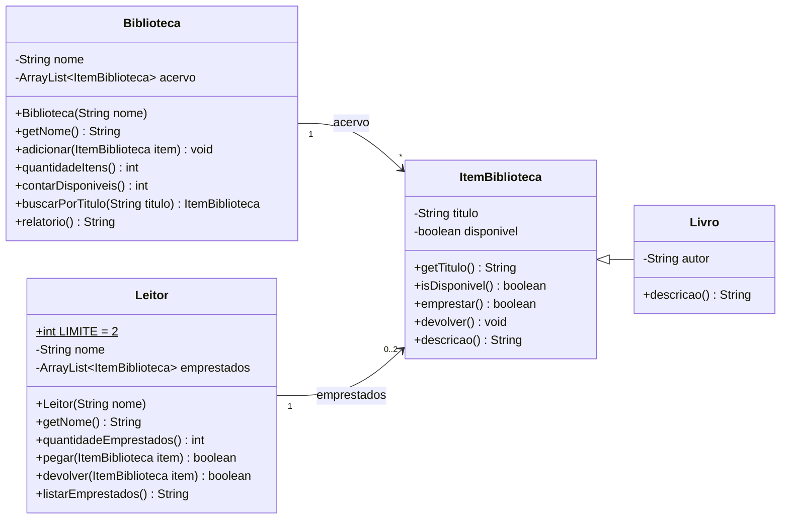

# Prática: leitores, acervo e ArrayList (biblioteca, parte 2)

POO I • 3º INF • 03/11/2026 • aulas 2 a 4

Continuação da prática de 27/10. Agora a biblioteca tem um **acervo** (lista de itens) e **leitores** que pegam e devolvem itens. Cada leitor fica com no máximo 2 itens.

## Como abrir

1. Copie esta pasta para o computador do laboratório.
2. **Antes de abrir:** copie o **seu** `ItemBiblioteca.java` e o **seu** `Livro.java` da prática de 27/10 (já corrigidos na aula 1) para a pasta `src` deste projeto. Sem eles o projeto não compila.
3. No NetBeans: **File > Open Project** e selecione a pasta `2026-11-03_Aula02_Leitores`.
4. Em Source Packages, complete os `TODO` de `Leitor.java` e `Biblioteca.java`.
5. Não altere o `main` de `Aplicacao.java`.
6. Botão direito em `Aplicacao.java` > **Run File** (Shift+F6). Confira a saída com os comentários do `main`.

## Diagrama de classes



`LIMITE` sublinhado na UML (`$`) é `static`: pertence à classe, não a cada leitor. Já vem pronto no molde.

## Regras que o código precisa cumprir

**Leitor**

- Nome nulo ou em branco gera `IllegalArgumentException`. A lista `emprestados` nasce vazia **no construtor**.
- `pegar(item)`: se o leitor já tem `LIMITE` itens, retorna `false`. Senão, manda a mensagem `item.emprestar()`; se o item recusar, retorna `false`. Se aceitar, guarda o item na lista e retorna `true`.
- `devolver(item)`: só devolve o que está na lista do leitor. Se não estiver, retorna `false` e não mexe em nada. Se estiver, tira da lista, manda `item.devolver()` e retorna `true`.
- `listarEmprestados()`: `Ana está com:` e uma linha `- descrição` para cada item.

**Biblioteca**

- Nome nulo ou em branco gera `IllegalArgumentException`. Adicionar `null` também.
- `contarDisponiveis()` percorre o acervo e conta os itens disponíveis.
- `buscarPorTitulo(titulo)` ignora maiúsculas e minúsculas (`equalsIgnoreCase`). Se não achar, retorna `null`.
- `relatorio()`: o nome da biblioteca e uma linha por item, começando com `[disponível]` ou `[emprestado]`.

## ArrayList em 5 linhas

```java
ArrayList<ItemBiblioteca> lista = new ArrayList<>(); // lista vazia
lista.add(item);                // adiciona no fim
lista.size();                   // quantos itens tem
lista.contains(item);           // true se aquele objeto está na lista
lista.remove(item);             // tira aquele objeto da lista
for (ItemBiblioteca i : lista) { /* percorre um por um */ }
```

Precisa de `import java.util.ArrayList;` no topo do arquivo (já está no molde).

## Desafio extra (para quem terminar)

1. Crie `Revista`, subclasse de `ItemBiblioteca`, com `-int edicao` (maior que zero). `descricao()` devolve `Revista: <título> | Edição <n>`.
2. No `main`, crie uma revista, adicione ao acervo, empreste ao Bruno e imprima o relatório. Você precisou mudar `Leitor` ou `Biblioteca`? Por quê?

## Plano B, sem o NetBeans

No terminal, dentro desta pasta:

```powershell
New-Item -ItemType Directory -Force -Path build\classes | Out-Null
javac -encoding UTF-8 -d build\classes src\*.java
java -cp build\classes Aplicacao
```
